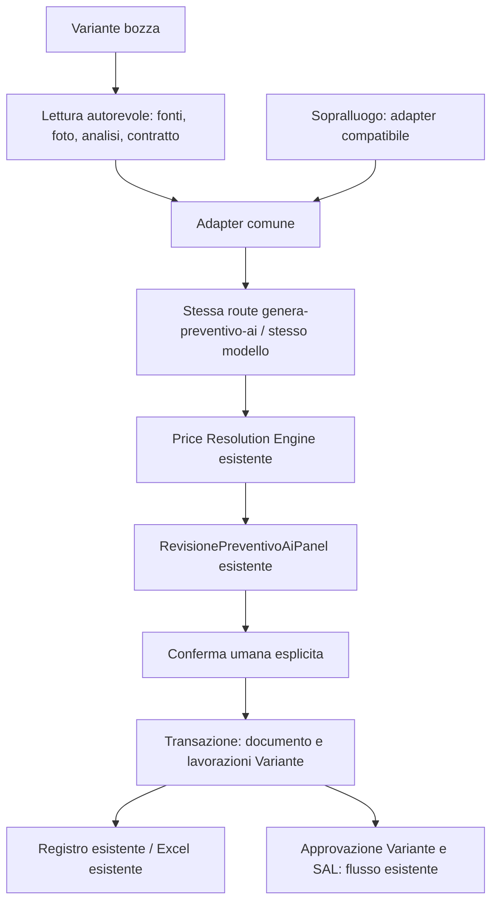

# Step 5 — Preventivo Integrativo

Implementazione locale dalla baseline `1f65385315059275f01f7d622b72ed4054a7565b`. Nessuna applicazione SQL, pubblicazione o chiamata AI reale durante la verifica.

## API e separazione dei contesti

`contestoSopralluogo(input)` mantiene il Memory legacy e il payload precedente. `contestoVariante(snapshot)` restituisce `PreventivoGenerationContext`: narrativa dal composer comune, foto separate, contratto strutturato, genealogia. `decodificaSnapshotIntegrativo` valida la risposta autorevole; `leggiRispostaIntegrativa` applica il Price Engine; `validaRevisione` valida la conferma umana.

Il browser invia alla stessa route soltanto `{ "tipo": "integrativo", "variante_id": "…" }`, con sessione autenticata. Il server rilegge il contesto, non accetta prezzi/contratto/fonti dal browser. Il ramo Sopralluogo conserva prompt, modello `gpt-4.1-mini` e `json_object`: due golden fixture verificano la richiesta precedente. Le istruzioni delta e il contratto sono input separati dalla narrativa. Esempi completi, JSON AI mock e risultato revisionato sono in `esempi.fixture.json`; la ricostruzione iniziale è in `MAPPA-STEP5.md`.

Le operazioni sono nuova/aumento/riduzione/eliminazione; una sostituzione si rappresenta con due righe revisionate. Un riferimento incerto rimane vuoto e da verificare. Le detrazioni sono negative. Il prezzo AI non sostituisce il Price Engine; quantità e prezzo delle correzioni devono coincidere con quelli autorevoli. Nessun salvataggio alla sola risposta AI. L'analisi obsoleta blocca la generazione senza rianalisi automatica. Se esiste un'analisi vengono confrontati attivamente anche gli hash byte foto già previsti dall'Osservatore; non viene introdotto un versioning passivo Storage.

## Persistenza locale proposta

SQL integrale: `supabase/migrations/20261025_variante_preventivo_integrativo.sql`.
SHA-256 sui byte: `39466e294f7d197bbae60dbe2274cf2514adb8bffeb82ee3d2bcb25acfddd88c`.

Estende il Registro esistente con natura, variante_id, preventivo_contrattuale_id, provenienza_generazione, FK RESTRICT, check e unique per Variante; sopralluogo_id conserva l'origine del contratto. Non modifica origine_preventivo_id né il riferimento contrattuale della Variante. Introduce guard del documento e RPC `leggi_contesto_preventivo_integrativo(uuid)` / `salva_preventivo_integrativo_generato(uuid,uuid,text,text,jsonb)`, SECURITY DEFINER con ruolo tecnico esistente, EXECUTE solo authenticated. Un grant aggiuntivo consente al ruolo tecnico la lettura Osservatore. Non riscrive RPC economiche esistenti.

La conferma atomica crea documento e lavorazioni; riduzioni/eliminazioni delegano la correzione canonica e il relativo residuo SAL. Retry con stesso UUID e identico payload riconosce il commit; payload diverso viene rifiutato. Nessun retry automatico del client dopo esito incerto. Registro e somme contrattuali escludono il documento integrativo come contratto indipendente; il documento non approva Variante, contratto o SAL. Excel conserva segni e riferimenti senza aggiungere condizioni commerciali standard.

Scelta prudenziale esplicita: solo bozze prive di lavorazioni economiche; un documento generato confermato per Variante. Nessuna fusione implicita con righe manuali o nuova conferma dopo modifica delle fonti. Prima della conferma è possibile scartare e rigenerare.

## Verifiche e limiti

- Nuovi test: 33/33, provider/HTTP simulati, componenti reali eseguiti con hook fixture, SQL effettivo su PGlite e ExcelJS/template effettivi. Test di parità legacy inclusi.
- Suite ampliata: 294/294 eseguiti. Due prove native Economia escluse esplicitamente dalla corsa verde: runtime PostgreSQL disponibile incompleto (`postgres.bki` mancante); tentativi falliti conservati. Nessuna certificazione di concorrenza PostgreSQL nativa o HTTP/browser reale Step 5.
- TypeScript: ExitCode 0. ESLint nuovi moduli/pannello/route: ExitCode 0. Sui sei file legacy toccati persistono gli stessi 171 errori e 256 warning della baseline, con stessi conteggi per file; ESLint globale non GREEN. Build non eseguita.
- SQL embedded usa i corpi reali di residuo/correzione; la definizione della RPC legacy aggiungi_lavorazione_variante non è versionata: fixture minima per questa dipendenza e per la lettura Osservatore.
- Prima di attivare: precheck Production READ ONLY su schema, firme, ACL, owner e shape reale della RPC legacy. Nessun precheck remoto eseguito qui.
- **Compatibilità ancora bloccante per il rilascio:** verificare il percorso amministrativo di eliminazione Cantiere (`artecna_cantieri_delete_rpc`) contro nuove FK e guard documentale. Il guard consente scritture integrative al solo ruolo Variante e può fermare la cancellazione amministrativa. Non sono state alterate RPC distruttive fuori scope e non è stata certificata tale compatibilità.
- Foto senza versione passiva: sostituzione agli stessi ID/path non osservabile dal solo SQL; possibile cambiamento byte fra generazione e conferma. Nessuno snapshot immutabile dei blob introdotto.

Configurazione, ENV e credenziali preservati. Nessun valore segreto letto, stampato o copiato. I mock non inizializzano il provider reale.
