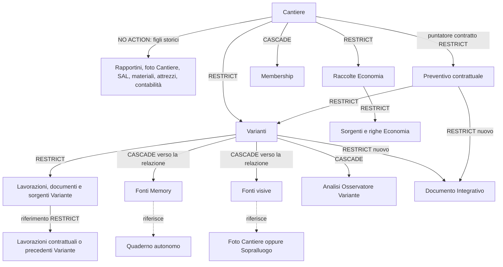

# Step 5A — compatibilità con cancellazione amministrativa

> Documento storico: le assunzioni di catalogo qui descritte sono superate dalla fotografia Production e dalle prove documentate in [STEP5C.md](./STEP5C.md). Per baseline, FK e fingerprint usare Step 5C.

Base: `1af348a5968afe87d2513f655612e1178b100d86`. Analisi e prove esclusivamente locali con dati sintetici. Nessuna lettura o scrittura Production necessaria in questo step. Le descrizioni del catalogo provengono dalle fixture/versioni SQL già presenti, non da una nuova fotografia Production.

## Percorso effettivo

`app/page.tsx` mostra «Elimina cantiere», apre il dialog a due fasi e richiede `ELIMINA`. `eseguiEliminazioneCantiere()` chiama direttamente `supabase.rpc('elimina_cantiere_definitivamente', {p_cantiere_id, p_conferma:'ELIMINA'})`. Nessuna API intermedia. Il client azzera soltanto lo stato locale dopo una risposta server valida; non cancella Storage.

La RPC ha firma `public.elimina_cantiere_definitivamente(uuid,text)`, SECURITY DEFINER del ruolo NOLOGIN `artecna_cantieri_delete_rpc`. La versione effettiva è il corpo `$rpc_new$` di `20261007_f3c33_manifest_eliminazione_cantiere.sql`, dopo le revisioni Economia e foto/rapportini. Gli helper privati di contesto, manifest e outbox sono SECURITY DEFINER **postgres**, non del ruolo della RPC.

Ordine originale: lock Cantiere e owner → verifica foto legacy → contesto certificato (inventario FK, rapportini strutturati protetti) → lock Varianti/raccolte/figli → verifica riferimenti fuori perimetro → manifest → outbox Storage → righe/sorgenti/raccolte Economia → SAL → documenti Variante → lavorazioni Variante dalle foglie della self-FK → sorgenti Variante → Varianti → azzera solo preventivo_contrattuale_id del Cantiere → lavorazioni contrattuali → preventivi → foto Cantiere → materiali/attrezzi/timbrature/pagamenti/acconti/fatture/incassi/rapportini → postcheck → chiusura contesto → membership → Cantiere → postcheck finale. Gli errori FK annullano atomicamente l'operazione.

L'outbox `artecna_distruzione.cleanup_storage` registra i percorsi reali `file_path` di preventivi/foto/materiali/attrezzi e `storage_path` dei documenti Variante nel bucket `preventivi`, con UNIQUE(cantiere_id,bucket,path). `prepara_cleanup_storage` e `impronta_cleanup_storage` restano identici. La RPC non elimina byte Storage e non viene introdotto alcun nuovo worker. I test certificano record/outbox e deduplicazione dei job, non cancellazioni HTTP o byte fisici.

## Grafo delle relazioni effettive

La lista completa delle FK entranti del perimetro storico è estratta dal letterale `$inventory$` di F3C3.3; il test ricrea nome, colonne, destinazione e ON DELETE, mantenendo attive tutte le FK. Le tre tabelle Step 3/4 sono create dal loro SQL effettivo. Nessuna FK è tolta per far passare la cancellazione corretta.

Le frecce tratteggiate NON sono direzioni di cascata verso la risorsa. Il padre Quaderno/foto, se eliminato autonomamente, può eliminare la relazione figlia; eliminare la relazione non elimina il padre.

Non esiste nel perimetro fotografato una FK Cantiere → Sopralluogo: il Sopralluogo non viene distrutto da questa RPC. `preventivi_cantiere.cantiere_id` e `sopralluogo_id` sono nullable e non figurano come FK nel catalogo storico disponibile. La RPC usa il cantiere_id UUID per delimitare i preventivi, non il nome legacy. Non viene inventata una nuova FK né una colonna sopralluogo_origine_id: la genealogia riusa sopralluogo_id.

| Figlia / colonne | Padre | Nullabilità | ON DELETE / conseguenza |
|---|---|---|---|
| preventivi_cantiere.variante_id (nuova) | varianti_cantiere.id | nullable globalmente, obbligatoria per Integrativo via CHECK | RESTRICT: documento da eliminare prima della Variante |
| preventivi_cantiere.preventivo_contrattuale_id (nuova) | preventivi_cantiere.id | nullable globalmente, obbligatoria per Integrativo | RESTRICT: Integrativi prima del contratto |
| preventivi_cantiere.cantiere_id / sopralluogo_id | genealogia UUID esistente | nullable; cantiere obbligatorio per Integrativo via CHECK | nessuna FK nel perimetro fotografato; selezione esplicita della RPC |
| cantieri.preventivo_contrattuale_id | preventivi_cantiere.id | nullable | RESTRICT: azzerato nel solo Cantiere target prima del contratto |
| cantieri.origine_preventivo_id | genealogia origine esistente | nullable | nessuna FK entrante nel manifest disponibile; semantica e valore non modificati dalla patch |
| varianti_cantiere.cantiere_id / preventivo_contrattuale_id | cantieri.id / preventivi_cantiere.id | NOT NULL | RESTRICT: figli e Variante prima del contratto/Cantiere |
| variante_lavorazioni.variante_id | varianti_cantiere.id | NOT NULL | RESTRICT: righe prima della testata |
| variante_lavorazioni.riferimento_preventivo_lavorazione_id | preventivo_lavorazioni.id bigint | nullable, obbligo alternativo per operazioni diverse da nuova | RESTRICT: correzioni prima delle lavorazioni base |
| variante_lavorazioni.riferimento_variante_lavorazione_id | variante_lavorazioni.id bigint | nullable, alternativo al riferimento base | RESTRICT: cancellazione topologica già esistente |
| variante_fonti_memory.variante_id / source_id | Variante / Quaderno | NOT NULL | CASCADE padre→sola relazione; Quaderno mai cancellato per questa cascata |
| variante_fonti_visive.variante_id | Variante | NOT NULL | CASCADE padre→relazione |
| variante_fonti_visive.foto_cantiere_id / foto_sopralluogo_id | rispettivo record foto | generated nullable, solo quella relativa al tipo è valorizzata | CASCADE foto→relazione, mai il contrario |
| variante_osservatore_analisi.variante_id | Variante | NOT NULL | CASCADE: analisi appartenente esclusivamente alla Variante |

Eliminare un Integrativo non cancella Variante o contratto; la rimozione diretta resta vietata dal guard. Eliminare direttamente Variante o contratto con documento presente rimane rifiutato da RESTRICT. La cancellazione amministrativa elimina esplicitamente i documenti nel contesto autorizzato. Eventuali riferimenti provenienti da un altro Cantiere fanno fallire l'intera transazione, proteggendo le risorse condivise.

## Diagnosi e correzione minima

Il problema precede in parte Step 5: le relazioni Step 3/4 rendono divergente l'inventario chiuso in `inizia_contesto`, anche quando vuote. Step 5 aggiunge due FK RESTRICT e il guard del documento. La sola aggiunta di CASCADE o l'apertura indiscriminata del guard sarebbe insufficiente.

La sola migrazione Step 5, ancora non installata, ora:

1. Certifica gli hash dei tre corpi storici prima di modificarli; se divergono, rollback completo.
2. Aggiunge al manifest e al perimetro dei figli le tre tabelle fonti/analisi, mantenendo i controlli cross-Cantiere e quelli strutturati dei rapportini.
3. Cancella esplicitamente soltanto le relazioni/analisi delle Varianti target; non visita né elimina Quaderni/foto Sopralluogo.
4. Elimina gli Integrativi prima delle Varianti e dei contratti, sommando correttamente i conteggi nel manifest. Mantiene entrambe le nuove FK RESTRICT e la UNIQUE di un Integrativo confermato per Variante.
5. Consente al guard solo DELETE eseguita dal ruolo amministrativo con contesto valido per OLD.cantiere_id. Nessun INSERT/UPDATE amministrativo sbloccato.
6. Concede al solo ruolo tecnico SELECT/DELETE sulle nuove tabelle e UPDATE(variante_id) necessario per FOR UPDATE; nessun grant browser. Conserva owner, ACL e configurazione delle funzioni esistenti; i tre corpi certificati sono le sole modifiche alla distruzione. Il grant di lettura Osservatore al ruolo Variante è quello già previsto da Step 5.

Le migrazioni precedenti e runtime UI/AI sono invariati. Nessuna modifica al significato di origine_preventivo_id o preventivo_contrattuale_id. L'unico documento per Variante è un vincolo già stabilito nello Step 5: il caso «più Integrativi stessa Variante» verifica il rifiuto 23505 del secondo, non inventa una molteplicità incompatibile.

## Matrice delle prove

`cleanup.native.test.mjs`: PostgreSQL 18.6 reale, loopback e cluster sintetici distinti; SQL effettivo, FK attive, corpi RPC/helper versionati, verifiche prima/dopo. La fixture riduce le colonne estranee allo scenario, non rappresenta un clone Production. Auth è simulata con JWT locale; nessuna API/Storage/AI remota.

| Requisito | Evidenza |
|---|---|
| 1. Cantiere senza Variante | baseline precedente senza nuove strutture e cleanup corretto senza Variante |
| 2. Variante senza Integrativo | cancellazione completa con vincoli attivi |
| 3. Variante con Integrativo | documento rimosso prima della testata e del contratto |
| 4. Lavorazioni atomiche | nove test persistenza eseguiti anche su PostgreSQL nativo: quattro operazioni, rollback ultima riga, retry |
| 5. Riferimento contrattuale | righe aumento collegate alla lavorazione bigint, nessun errore RESTRICT |
| 6. Quaderno | relazione assente, record autonomo ancora presente |
| 7. Foto | foto Cantiere target rimossa; relazione rimossa; foto Sopralluogo autonoma preservata |
| 8. Osservatore | analisi della Variante rimossa; nessuna chiamata AI |
| 9. Più Integrativi stessa Variante | secondo rifiutato 23505, UNIQUE preservata |
| 10. Più Varianti | due Varianti e due documenti distinti eliminati coerentemente |
| 11. Nessun orfano | zero righe target in testate, documenti, lavorazioni, fonti e analisi; FK mai disabilitate |
| 12. Altro Cantiere | Cantiere e contratto esterni preservati; relazione esterna verso foto target provoca rollback |
| 13. FK | nessuna violazione nei casi consentiti, controllo fail-closed del riferimento esterno |
| 14. Storage | un solo job per path condiviso fra record target, nessun job per Quaderno/foto Sopralluogo; nessun worker aggiunto |

Il vecchio comportamento incompatibile è riprodotto con SQL originale Step 5 dal blob Git e rollback prima di qualunque outbox. Il controllo owner/config/ACL distingue esplicitamente l'unico grant Osservatore previsto. Le due prove native Economia prima non disponibili sono state recuperate sul runtime portabile verificato: lock selettivi, chiamate simultanee, modifica prima del lock e risposta persa dopo COMMIT.

Il vecchio harness F3C3.3 è eseguito separatamente su PostgreSQL 17.6, con 10/10 PASS. La prima corsa falliva l'hash del prerequisito per i CRLF fisici del checkout Windows. Il bootstrap di audit normalizza solo la lettura in memoria a LF; file SQL precedenti invariati. Tutti i tentativi e i log restano conservati.

Esito finale: suite completa **321/321 PASS**, zero esclusioni, inclusi 33 test Step 5 e 11 controlli raggruppati della matrice nativa. Persistenza ripetuta separatamente su PostgreSQL nativo: **9/9 PASS**. Due prove Economia recuperate: **16/16 PASS**. Regressione storica cleanup: **10/10 PASS**. TypeScript ExitCode 0; lint dei due moduli ESM nuovi ExitCode 0. Il test CJS modificato conserva esattamente i sei errori no-require-imports già presenti nella sua baseline; runtime TS/TSX identico al candidato Step 5, lint legacy riutilizzato senza aumento. Build non necessaria per modifiche solo SQL/test/documentazione.

SQL finale: `20261025_variante_preventivo_integrativo.sql`; SHA-256 sui byte via .NET **45af46251f0bb226af2cc38893e61475dfcce14b603d027c3148b434e897ef36**. L'hash precedente `39466e…` è superato. Nessuna procedura Production è preparata in questo step.
